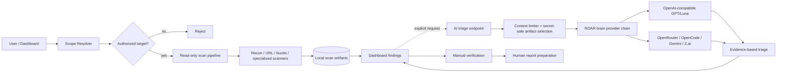

# ROAR AI-assisted scanning architecture

ROAR remains fully usable without an AI provider. AI is an optional, post-scan triage layer: deterministic scanners collect evidence first, then a human explicitly requests analysis.



## AI boundaries

- No AI output is executed as a command.
- No automatic report submission.
- AI receives local scan artifacts, not arbitrary out-of-scope targets.
- Findings are hypotheses until manually reproduced.
- Without AI keys, deterministic scanning and dashboard findings continue normally.

## Configuration

```env
ROAR_AI_API_KEY=...
ROAR_AI_ENDPOINT=https://provider.example/v1/chat/completions
ROAR_AI_MODEL=gpt-5.6-luna
```

The endpoint must accept an OpenAI-compatible request and return `choices[0].message.content`.

## Explicit analysis API

```http
POST /api/scans/{scan_id}/ai-analysis
```

The response contains `manual_review_required: true`. If no provider is configured, the endpoint returns `503` while the scan itself remains successful.
