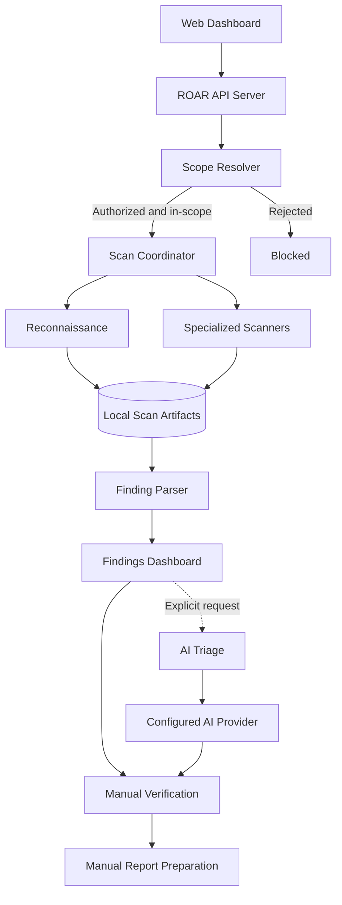

# ROAR Local Website Documentation

## Start the website

```powershell
cd C:\Users\jeeva\ROAR-clean
.\roar.exe api
```

Open:

```text
http://127.0.0.1:8000/ui/
```

The local target used for testing is:

```text
http://localhost:3000/
```

Use the URL without `#/`; browser fragments are not sent to the server.

## Local configuration

`.env`:

```env
API_HOST=127.0.0.1
API_PORT=8000
ROAR_API_AUTH_DISABLED=true
DB_TYPE=sqlite
DB_HOST=C:\Users\jeeva\ROAR-clean\roar.db
```

The SQLite database is stored at `roar.db`. Scan artifacts are stored under `new-results/`.

## AI configuration (optional)

ROAR works without AI. To enable AI-assisted finding triage, configure an OpenAI-compatible provider:

```env
ROAR_AI_API_KEY=your-key
ROAR_AI_ENDPOINT=https://provider.example/v1/chat/completions
ROAR_AI_MODEL=gpt-5.6-luna
```

The model name and endpoint must be supplied by the provider. ChatGPT web OAuth alone is not an API credential.

AI is never required for deterministic scans, monitoring, recon, or Nuclei. AI output is advisory and requires manual verification.

## Main workflows

1. Add or resolve an authorized target.
2. Run recon or a scoped program scan.
3. Run Nuclei or another appropriate scanner.
4. Review findings in **Scans**.
5. Optionally request AI triage.
6. Reproduce findings manually.
7. Prepare reports manually; ROAR does not submit reports automatically.

## Important API endpoints

| Method | Endpoint | Purpose |
|---|---|---|
| GET | `/api/config` | Configuration and provider status |
| GET | `/api/scans` | List scans |
| POST | `/scan/nuclei` | Start a Nuclei scan using `domain` or `url` |
| POST | `/api/pipeline/program-scan` | Start a server-resolved scoped program scan |
| POST | `/api/scans/{id}/ai-analysis` | Explicit AI triage of local scan artifacts |
| GET | `/api/scans/{id}/results/parsed` | Parsed findings |
| POST | `/api/monitor/url-targets` | Add URL monitoring target |
| GET | `/api/monitor/targets` | List URL monitors |
| GET | `/api/r2/files` | List R2 artifacts; returns local-first response when R2 is disabled |

Example URL scan:

```powershell
$body = @{ url = 'http://localhost:3000/'; mode = 'full' } | ConvertTo-Json
Invoke-RestMethod -Method Post -Uri http://127.0.0.1:8000/scan/nuclei -ContentType 'application/json' -Body $body
```

## AI triage API

```http
POST /api/scans/{scan_id}/ai-analysis
```

The endpoint reads local scan artifacts and asks the configured provider to return evidence, confidence, severity, safe verification steps, remediation, and false-positive notes.

It does not execute model-generated commands or submit reports. Without AI configuration it returns `503` while the scan system continues to work.

## Architecture and how ROAR works



### Runtime flow

1. The browser sends a request to the Go API server.
2. The API validates the request and resolves authorized scope on the server.
3. The scan coordinator starts only the selected in-scope targets.
4. Recon and specialized scanners run with local-first artifact storage.
5. Result files are indexed and parsed into dashboard findings.
6. Users review evidence and manually reproduce possible issues.
7. SPA URL scans run a bounded, same-origin headless crawl and record browser network requests for API discovery.
8. AI triage is optional and runs only when explicitly requested against local artifacts.
9. ROAR never executes AI-generated commands and never automatically submits bounty reports.

### Main components

| Component | Responsibility |
|---|---|
| Web UI | Scan launcher, program scope, findings, monitors, settings |
| API server | Authentication, validation, scope enforcement, scan lifecycle |
| Scope resolver | Prevents browser-supplied out-of-scope targets |
| Scan coordinator | Runs recon, Nuclei, URL, JS, DNS, and specialized modules |
| SQLite database | Local configuration, scans, findings, programs, monitors |
| Artifact store | Local scan JSON/text output under `new-results/` |
| Finding parser | Converts scanner output into consistent dashboard rows |
| AI brain | Optional provider routing and evidence-based triage |
| Manual review | Required before reporting or remediation decisions |

### Trust boundaries

- **Browser to API:** requests are validated; scope is not trusted from the browser.
- **API to targets:** only server-resolved authorized targets are scanned.
- **Scanner to artifacts:** scanner output is treated as untrusted evidence.
- **Artifacts to AI:** context is limited; AI output is advisory only.
- **AI to execution:** there is no execution path from model output.
- **Findings to reporting:** reports remain manual and are never submitted automatically.

See [`ai-architecture.md`](ai-architecture.md) for the standalone architecture reference.

## Verification commands

```powershell
cd C:\Users\jeeva\ROAR-clean
go test ./internal/api ./internal/app ./internal/brain ./internal/config ./internal/scanner/... ./internal/utils
go build -o roar.exe ./cmd/roar
```

JavaScript syntax can be checked with:

```powershell
node --check internal/api/ui/app.js
```
